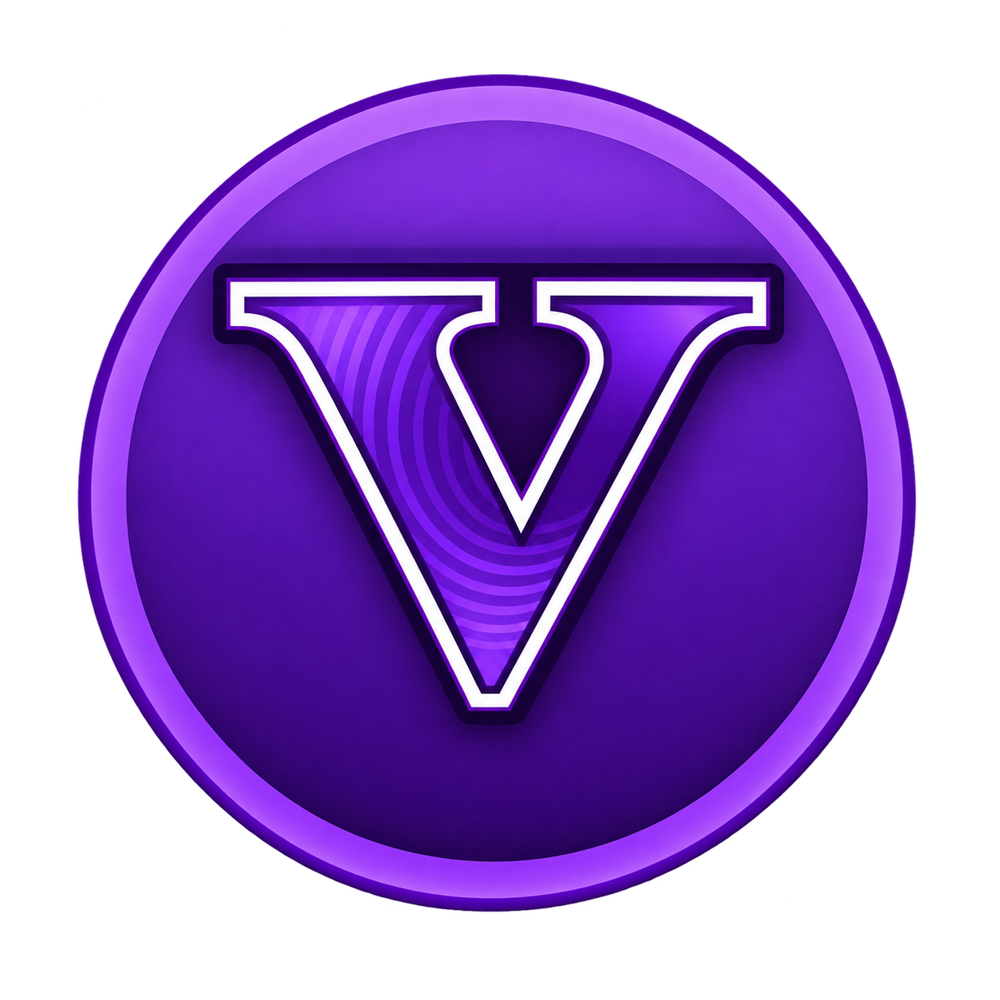

<p align="center"></p>

# XHYN V

**XHYN V brings GTA V to Android with touch controls, graphics and driver settings, and a Story Mode trainer.** Maintained by **XHYN-PH**, this edition brings setup and performance controls together so you can adjust the game for your device.

**[Download XHYN V 0.2 Hotfix 2](https://github.com/XHYN-PH/XHYN-V-reborn/releases/tag/v0.2-hotfix2)** · **[Telegram](https://t.me/xhynv)** · **[YouTube](https://youtube.com/@xhyn_ph)** · **[Buy GTA V](https://store.rockstargames.com/game/buy-gta-v)**

## What does this project provide?

XHYN V combines an Android launcher and native ARM64 runtime with our interface, branding and language updates. Select your compatible game-data folder, configure your controls and graphics, and launch directly from the app.

**The APK does not bundle GTA V game data.** You need your own compatible game files and must own the game.

[**Buy the real game from the official Rockstar Store →**](https://store.rockstargames.com/game/buy-gta-v)

Rockstar's PC purchase includes **GTAV Enhanced and GTAV Legacy**. This port expects compatible **Legacy** files; ownership does not make every game version or Enhanced data set compatible with it. Follow the version requirements for the build you install.

## Is this a native port or an emulator?

**XHYN V runs its game engine as native ARM64 Android code.** Our build loads the 64-bit `libgtav.so` game library through Android/SDL's native entry point. Native describes the CPU code that runs the game; graphics translation is a separate part of the architecture. See [how our runtime works](docs/SOURCE.md).

**We use DXVK to translate graphics calls.** On the DXVK path, Direct3D 11/DXGI calls are translated into Vulkan while the game code runs as ARM64 instructions. [DXVK Native](https://github.com/doitsujin/dxvk#dxvk-native) supports native game ports **without Wine**. Using a graphics compatibility layer does not turn native game code into CPU emulation.

Our DXVK rendering path:

```text
Android/SDL → ARM64 game engine
                  └─ Direct3D 11/DXGI → DXVK → Vulkan → GPU driver
```

**GPU support is a separate question.** Our renderer depends on driver features, texture formats and Vulkan behavior. Support for a particular GPU family does not change the CPU architecture of the game runtime.

XHYN V is therefore **a native ARM64 Android port with graphics API translation where needed**. We build on the original Android port and maintain this edition's improvements. Native execution does not imply that every rendering path was rewritten directly for Vulkan or that the complete engine source is public.

## Features

- **Game setup:** select a game folder, manage resources, and access archive extraction/moving tools.
- **Touch and controller controls:** selectable/editable layouts, controls for different game states, camera/aim options, gyroscope and tilt-steering settings.
- **Graphics and memory controls:** a 0–100% render-scale slider (0 uses game resolution), recorded graphics-default restoration, individual quality options, a lower-settings shortcut, population density, draw distance and texture-detail settings.
- **Frame-rate controls:** rendered FPS cap, VSync, frame latency and display-refresh matching, with separate rendered/generated FPS labels for optional frame generation.
- **DXVK tuning:** renderer-aware controls for VRAM reports, memory budget, shader compilation/caches, filtering and advanced compatibility options. Buttons and the `dxvk.conf` editor share the same active settings. Information buttons explain purpose, possible benefits and tradeoffs. [Tuning guide](modifications/v0.2/DXVK-TUNING.md).
- **Vulkan drivers:** System Vulkan, imported Android Vulkan drivers, experimental PanVK/Mali and Xclipse paths, plus Turnip GMEM/SYSMEM and One UI controls. An optional draw/present check helps identify driver problems; a pass does not guarantee gameplay compatibility.
- **Shader caches:** separate cache locations by renderer and driver package, preserved across launches, with manual cleanup.
- **Story Mode trainer:** character, vehicle, weapon and world options, vehicle customization, favorites and presets.
- **Mods and custom radio:** resource-mod import interfaces, supported audio importing, previews and Self Radio management. ASI/DLL loading is not provided.
- **Diagnostics:** a simple record-next-game and save-report flow, plain-language error explanations, and optional memory/graphics measurements. Advanced diagnostic actions remain available.
- **Project links:** an About page inside System, below Game Resources opens Telegram, YouTube and this repository. Menus and trainer presentation are in English, with no Chinese system-language requirement.

XHYN V 0.2 uses the newer 1.7.26 runtime and retains its download page, PC-style trainer, touch layouts, custom radio and frame-generation options. Frame generation starts disabled on fresh installs. Compatibility and performance depend on your device, driver, settings and game data; experimental driver support does not imply support for every GPU.

## Requirements and installation

- **Android 11 or newer**, an **ARM64** device and a compatible **Vulkan** driver.
- Your own compatible **GTA V Legacy** files, including English text and fonts. The project's documented baseline is **1.61 / build 2699**.
- Enough storage for the game, caches and imported content.

1. Download and install the APK from the [release page](https://github.com/XHYN-PH/XHYN-V-reborn/releases/tag/v0.2-hotfix2).
2. Grant the requested file access and select the folder containing `common.rpf`, `x64` and `update`.
3. Use **Display** for graphics, **Performance** for FPS, **Vulkan Drivers** for drivers, **DXVK** for configuration and **System → Diagnostics** for reports. Start with System Vulkan and lower settings if your device struggles.
4. Fully close and reopen the game after changing its driver, renderer or graphics settings. Graphics-file overrides take effect once the game has created `save/settings.xml`.

Start with default DXVK settings and change one option at a time. The DX10.1
compatibility limit is experimental and may prevent startup; restore Default or
DX11 if that happens. It still uses DXVK/Vulkan. Higher reported VRAM does not
add memory, and experimental overrides are not guaranteed performance boosts.

The [expanded improvement status](docs/issues/0.2-hotfix2-work-status.md) distinguishes implemented changes from engine work still awaiting matching source and device investigation.

Version 0.2 Hotfix 2 is a **development prerelease**, using the same app ID and release key as our previous English edition so it can install as an update. Device gameplay and GPU compatibility still need testing. Earlier editions with different app IDs remain separate installations.

## Source and credits

We publish [our 0.2 helper classes, native helper, patches, build tools and tests](modifications/v0.2), with **MIT licensing** for newly written code under its [defined scope](modifications/v0.2/PROVENANCE.md). This is the source for our modification layer. Original engine and launcher code remain subject to their own terms and are not published here. The earlier [1.7.4 English layer](modifications/english-1.7.4) remains available.

Credit for the original Android port, engine and third-party components belongs to their authors. See [source information](docs/SOURCE.md) and [credits/notices](docs/CREDITS.md).

For problems, include your phone/GPU, Android version, driver, renderer, game-data version and reproduction steps. Attach relevant diagnostics after removing personal information.

This project is unofficial and is not affiliated with Rockstar Games or Take-Two. GTA V and its associated assets belong to their respective rights holders.
