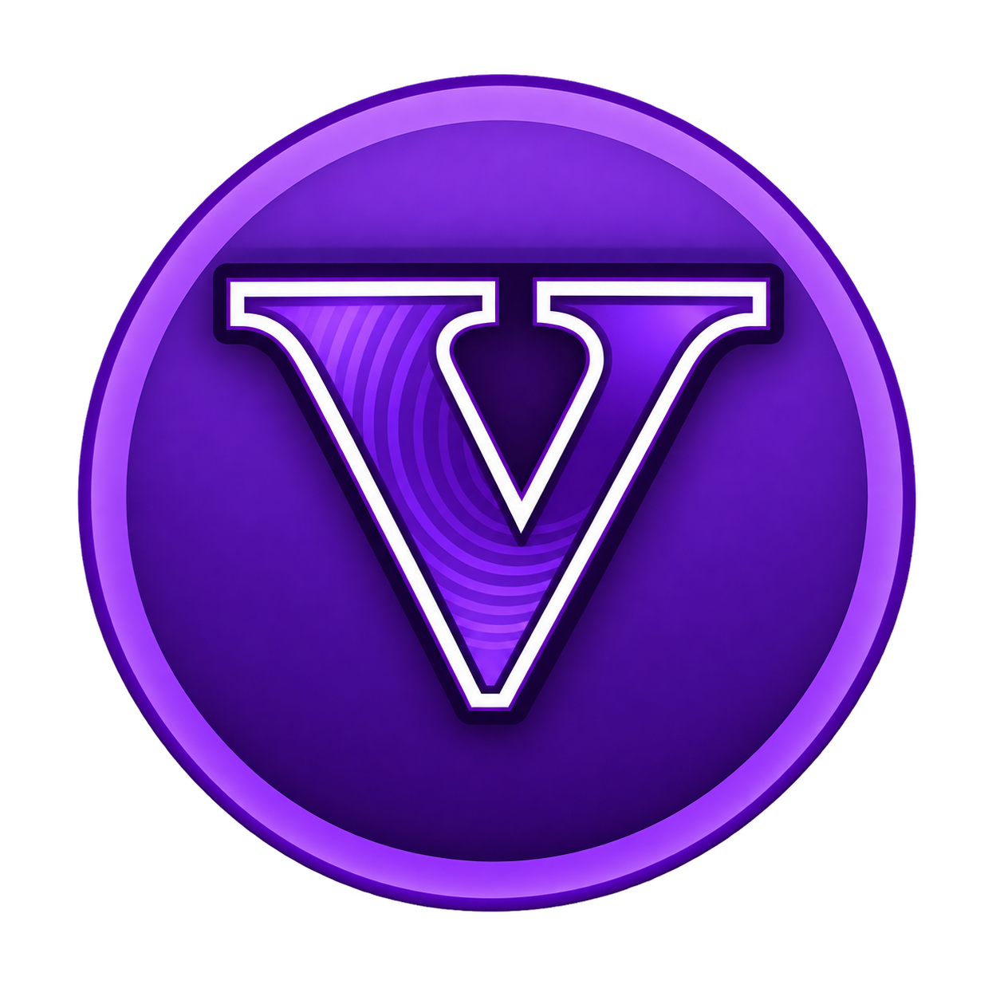

<p align="center"></p>

# XHYN V

**XHYN V brings GTA V to Android with touch controls, graphics and driver settings, and a Story Mode trainer.** Maintained by **XHYN-PH**, this edition brings setup and performance controls together so you can adjust the game for your device.

**[Download XHYN V 0.3 Preview 2](https://github.com/XHYN-PH/XHYN-V-reborn/releases/tag/v0.3-preview2)** · **[Telegram](https://t.me/xhynv)** · **[YouTube](https://youtube.com/@xhyn_ph)** · **[Buy GTA V](https://store.rockstargames.com/game/buy-gta-v)**

> **Untested development preview:** gameplay, live multiplayer and Bridge VPN behavior have not been verified on physical devices. Compatibility and performance vary; native crash fixes remain incomplete.

## What does this project provide?

XHYN V combines an Android launcher and native ARM64 runtime with our interface, branding and language updates. Select your compatible game-data folder, configure your controls and graphics, and launch directly from the app.

**The APK does not bundle GTA V game data.** You need your own compatible game files and must own the game.

[**Buy the real game from the official Rockstar Store →**](https://store.rockstargames.com/game/buy-gta-v)

Rockstar's PC purchase includes **GTAV Enhanced and GTAV Legacy**. This port expects compatible **Legacy** files; ownership does not make every game version or Enhanced data set compatible with it. Follow the version requirements for the build you install.

## Is this a native port or an emulator?

**XHYN V runs its game engine as native ARM64 Android code.** Our build loads the 64-bit `libgtav.so` game library through Android/SDL's native entry point. Native describes the CPU code that runs the game; graphics translation is a separate part of the architecture. See [how our runtime works](docs/SOURCE.md).

**We use DXVK to translate graphics calls.** On the DXVK path, Direct3D 11/DXGI calls are translated into Vulkan while the game code runs as ARM64 instructions. [DXVK Native](https://github.com/doitsujin/dxvk#dxvk-native) supports native game ports **without Wine**. Using a graphics compatibility layer does not turn native game code into CPU emulation.

Our DXVK rendering path:

```text
Android/SDL → ARM64 game engine
                  └─ Direct3D 11/DXGI → DXVK → Vulkan → GPU driver
```

**GPU support is a separate question.** Our renderer depends on driver features, texture formats and Vulkan behavior. Support for a particular GPU family does not change the CPU architecture of the game runtime.

XHYN V is therefore **a native ARM64 Android port with graphics API translation where needed**. We build on the original Android port and maintain this edition's improvements. Native execution does not imply that every rendering path was rewritten directly for Vulkan or that the complete engine source is public.

## 0.3 Preview 2 — launcher startup fix

- Fixed the immediate close before the launcher appeared: restored 146 original artwork files omitted during APK rebuilding.
- Preserved the original artwork authentication and touch icons.
- Added startup and launcher checks against the final signed APK's own resources on host Android 11 and Android 15.
- Kept the application ID and release key, with a newer version code for updating Preview 1. Bridge remains at 0.1.0.

**Preview 1 is superseded because it cannot open the launcher. Install Preview 2 from the download link above.** This fixes the reproduced packaging/startup failure; gameplay, GPU behavior and multiplayer still require physical-device testing.

## 0.3 feature changelog

The following base features and XHYN modifications were introduced in Preview 1 and carried forward into Preview 2.

### What's new in the 1.7.57 base

- **Experimental LAN free roam:** create or join rooms for **2–10 players, including the host**, using Wi-Fi, a hotspot or a virtual LAN.
- **Room tools:** room discovery, player names, a member list, connection/latency information, chat, host announcements and host-controlled friendly fire.
- **World synchronization:** character clothing/accessories, nearby vehicles and shared vehicle seating, with time, weather and nearby traffic following the host. Visual synchronization has not been verified on devices.
- **Street races:** record checkpoint routes, save recent tracks, choose sprint or circuit races, enter races and view results. Spawning/teleporting restrictions apply during races.
- **Launcher themes:** a separate Theme page, light/dark appearance, Liquid Glass controls and custom backgrounds.
- **More customization:** touch-layout screen fitting, scene/shared controls, layout ZIP imports, stick/sprint-lock appearance and custom mod display names.
- **Retained base features:** Story Mode trainer, touch/controller and motion controls, mod interfaces, resource management, custom radio and optional frame generation.

This is custom Story Mode/free-roam multiplayer. Mission progress is not shared. It does not provide Rockstar GTA Online, PC/console cross-play or compatibility between arbitrary game versions.

### Our modifications

- Migrated XHYN's controls and reporting to the new multiplayer base while keeping its engine and LAN components together.
- Applied the **XHYN V** name, transparent repository logo and English presentation to the new launcher, LAN/theme pages, trainer and messages. No Chinese system-language setting is required.
- Kept **Display**, **Performance**, **DXVK**, **Vulkan Drivers**, **Theme**, **LAN** and **System** navigation separate. About remains inside System, below Game Resources, with Telegram, YouTube and GitHub links.
- Preserved the **0–100% render scale**, graphics-quality resets, population/distance controls, rendered FPS cap, VSync and refresh options. Zero scale restores recorded game dimensions; positive scales keep a 320 × 180 minimum.
- Brought forward renderer-specific **DXVK tuning** for reported VRAM, shared memory, allocation budget, compiler workers, caches, filtering and compatibility options. Help buttons explain the tradeoffs. [Tuning guide](https://github.com/XHYN-PH/XHYN-V-reborn/blob/v0.3-preview2/modifications/v0.3/DXVK-TUNING.md).
- Kept tuning buttons, the editor and effective **dxvk.conf** synchronized. Consolidated the base's separate memory controls so a hidden override cannot silently replace these values.
- Retained one main Vulkan driver picker, experimental PanVK/Mali and Xclipse paths, and Turnip GMEM/SYSMEM plus One UI controls scoped to the appropriate driver. No universal GPU-support claim is made.
- Kept frame generation **off by default** on fresh installations and added clearer baseline/compatibility advice.
- Preserved renderer/driver-specific shader caches and removed repeated hashing of bundled libraries during normal startup.
- Fixed startup-log capture when a new log reuses the previous header. Prior logs are kept separately instead of being mistaken for the current attempt.
- Improved error explanations, memory/allocation information, applied-settings snapshots, pause/resume records and process-matched exit reports.
- Added **Compare two recordings**, which only compares recordings with matching renderer, driver and settings. It does not claim an FPS improvement or automatically change settings.
- Carried forward targeted audio, allocation and graphics-dispatch guards. General heap corruption, resource-cleanup and BC texture-copy problems remain under investigation.
- Added the separate **XHYN V Bridge 0.1.0** companion: English UI, native network messages, notifications and widgets; XHYN branding; compatible Astral room links; and connection tips. The networking backend is preserved. Room credentials are omitted from the server-start log.
- Kept the game's existing application ID and signing key so this preview can update the previous English edition. Bridge has its own application ID and installs separately.

**Untested gameplay preview:** physical-device gameplay, GPU behavior, live two-device multiplayer and Bridge VPN connections have not been tested. Expect possible crashes, disconnects or synchronization problems. The [detailed implementation status](https://github.com/XHYN-PH/XHYN-V-reborn/blob/v0.3-preview2/modifications/v0.3/STATUS.md) explains what changed and which native issues remain open.

## Requirements and installation

- **Android 11 or newer**, an **ARM64** device and a compatible **Vulkan** driver.
- Your own compatible **GTA V Legacy** files, including English text and fonts. The project's documented baseline is **1.61 / build 2699**.
- Enough storage for the game, caches and imported content.

1. Download and install the APK from the [release page](https://github.com/XHYN-PH/XHYN-V-reborn/releases/tag/v0.3-preview2).
2. Grant the requested file access and select the folder containing `common.rpf`, `x64` and `update`.
3. Use **Display** for graphics, **Performance** for FPS, **Vulkan Drivers** for drivers, **DXVK** for configuration and **System → Diagnostics** for reports. Start with System Vulkan and lower settings if your device struggles.
4. Fully close and reopen the game after changing its driver, renderer or graphics settings. Graphics-file overrides take effect once the game has created `save/settings.xml`.

Start with default DXVK settings and change one option at a time. The DX10.1
compatibility limit is experimental and may prevent startup; restore Default or
DX11 if that happens. It still uses DXVK/Vulkan. Higher reported VRAM does not
add memory, and experimental overrides are not guaranteed performance boosts.

The [improvement status](https://github.com/XHYN-PH/XHYN-V-reborn/blob/v0.3-preview2/modifications/v0.3/STATUS.md) separates completed changes from native heap, resource-cleanup and BC texture work that still needs matching source and device investigation.

Version 0.3 Preview 2 is a **development prerelease**, using the same app ID and release key as our previous English edition so it can install as an update. Device gameplay and GPU compatibility still need testing. Earlier editions with different app IDs remain separate installations.

## Multiplayer guide

> **Multiplayer is untested.** These steps follow the implemented menus, but local play, remote Bridge connections, racing and sustained sessions have not been verified on physical devices. Start with two players before trying a larger group.

### Before you begin

- Install the **same XHYN V APK version** on every phone.
- Each player needs their own compatible GTA V Legacy files. Use matching character, vehicle and other mod resources across the group.
- Make sure each phone can enter Story Mode on its own first. A VPN cannot fix a game that crashes or cannot load its resources.
- Begin with ordinary graphics settings and frame generation off while checking basic stability.

### Play nearby over Wi-Fi or a hotspot

1. Connect every phone to the same Wi-Fi, or have one phone create a hotspot for the others. Guest networks can prevent devices from communicating.
2. On the host phone, open **LAN multiplayer → Create room**. Leave **Virtual LAN off**.
3. Choose a player name and room limit, then create the room. Share the **host LAN IPv4** and **6-digit game room code** shown there.
4. On each other phone, open **Join room**, leave **Virtual LAN off**, and search for the room or enter the host IPv4 and room code manually.
5. After joining, every player enters **Story Mode separately** and meets at the same place. Joining the room does not load another player's save or synchronize missions.
6. Use the multiplayer overlay for the member list, chat and room tools. The host controls room settings and friendly fire.

### Play remotely with XHYN V Bridge

1. Install **XHYN V Bridge** from the [same release](https://github.com/XHYN-PH/XHYN-V-reborn/releases/tag/v0.3-preview2) on each phone. It is a separate app from the game.
2. Create/share or import the **same Bridge room/network** on every phone. Use matching network credentials and compatible enabled server settings.
3. Tap **Connect**, accept Android's VPN request and wait until Bridge shows a connected state and a **virtual IPv4 address**. Keep Bridge running when you switch to the game.
4. In XHYN V, the host opens **Create room** and enables **Virtual LAN**. Other players enable it on **Join room** too.
5. Share the host's **virtual IPv4 from Bridge** and the **6-digit game room code**. Enter those in the game, rather than the host's Wi-Fi or cellular address.
6. Each player enters Story Mode and meets at the same location, as in local play.

**The Bridge room and the game room are different.** A Bridge sharing link joins the virtual network; it is not the game's six-digit room code. Sharing links can contain network access details, so share them with your group carefully.

Keep the game allowed through the VPN; do not put it in the VPN bypass/exclusion list. If Android disconnects Bridge in the background, review its background/battery restrictions. Nearby Wi-Fi/hotspot play does not require Bridge.

### Chat, races and trainer behavior

- Use room chat for short messages; the host can publish announcements.
- The host can record or select a street-race route. Join the race and drive into the marked start area before the host begins it. Follow checkpoints in order.
- Multiplayer changes trainer access. Director Mode is disabled while connected; spawning and teleporting can be restricted during races or while wanted. Follow the on-screen messages and use the multiplayer overlay.
- Pausing or backgrounding the game can pause synchronization. Return to the game to resume; keep Bridge connected for remote play.
- Mission progress is not shared. This is not campaign co-op or official GTA Online.

### If something goes wrong

- **Room not found:** check Wi-Fi/hotspot connectivity and try the host IPv4/code manually. Confirm both players chose the same Virtual LAN setting.
- **Remote join fails:** confirm everyone is connected to the same Bridge network, use the host's virtual IPv4, and check that the game is allowed through the VPN.
- **Joined but players/vehicles do not appear:** enter Story Mode on every phone, meet at the same place and check that game versions and mod resources match.
- **Disconnects after switching apps:** keep Bridge connected and check Android's background restrictions. Return to the game to resume synchronization.
- **Game crash or severe stutter:** some native engine/texture issues remain unresolved. Open **System → Diagnostics**, turn on **Record next game**, reproduce it, then choose **Save report to share**. Include both phones' GPU/Android versions, renderer/driver, local or remote mode, and what happened.

## Earlier changelogs

<details>
<summary>0.2 Hotfix 2, 0.2 Hotfix 1, 0.2, 1.7.4 English and 0.1</summary>

### [0.2 Hotfix 2](https://github.com/XHYN-PH/XHYN-V-reborn/releases/tag/v0.2-hotfix2)

- Expanded renderer-aware DXVK controls for VRAM reports, shared memory, allocation budget, shaders, caches, filtering and advanced compatibility.
- Synchronized tuning buttons, the editor and effective configuration; added custom memory values and tuning reset.
- Added information buttons explaining settings and kept advanced DXVK options collapsed initially.
- Added adjustable 0–100% render scale and graphics-quality resets using recorded original values.
- Simplified Diagnostics to recording the next game and saving a report, with automatic recording stop.
- Added driver compatibility advice, display-refresh matching, optional Android 12+ scheduling hints and improved memory/graphics reports.
- Kept the DX10.1 compatibility limit experimental; it still uses Vulkan and may prevent startup.

### [0.2 Hotfix 1](https://github.com/XHYN-PH/XHYN-V-reborn/releases/tag/v0.2-hotfix1)

- Fixed System navigation and restored Diagnostics and Game Resources access.
- Moved About inside System, below Game Resources.
- Matched new controls to the launcher and separated graphics, performance, DXVK and diagnostics sections.
- Removed the duplicated custom-driver picker.
- Fixed graphics settings saving and setup failures mislabeled as invalid game folders.
- Preserved saved configuration text when overrides could not be applied.

### [0.2](https://github.com/XHYN-PH/XHYN-V-reborn/releases/tag/v0.2)

- Moved to the 1.7.26 base and added graphics, resolution, population, distance and FPS controls.
- Added the dxvk.conf editor, imports, saved overrides and effective-settings preview.
- Added experimental PanVK/Xclipse paths, driver checks, and Turnip GMEM/SYSMEM and One UI options.
- Added targeted crash handling, timed capture and reports.
- Added project links through About and retained the resource/download components. Navigation and placement were corrected in Hotfix 1.

### [1.7.4 English](https://github.com/XHYN-PH/XHYN-V-reborn/releases/tag/v1.7.4-en)

- Translated launcher pages, dialogs, notifications, accessibility/layout labels and trainer display data.
- Removed the Chinese system-language requirement while preserving filenames, game settings and graphics options.
- Retained touch/controller controls, mods, trainer and custom radio.
- Published the English modification source and build tools.

### [0.1](https://github.com/XHYN-PH/XHYN-V-reborn/releases/tag/v0.1)

- Started XHYN V Reborn with English launcher/trainer/touch presentation and linked menu/game-language selection.
- Repaired the Chinese-only system-language check, with English as the default/fallback.
- Added the DXVK configuration switch/editor, shader compiler-thread and refresh controls.
- Separated graphics caches by driver and improved crash reporting/export.
- Improved restart/shutdown handling and published the modification source.

Earlier builds were also development releases. Their changelogs do not establish physical-device gameplay or performance qualification.

</details>

## Source and credits

We publish [our 0.3 helper classes, native helper, patches, build tools and tests](https://github.com/XHYN-PH/XHYN-V-reborn/tree/v0.3-preview2/modifications/v0.3), with **MIT licensing** for newly written game-modification code under its [defined scope](https://github.com/XHYN-PH/XHYN-V-reborn/blob/v0.3-preview2/modifications/v0.3/PROVENANCE.md). This is the source for our modification layer. Original engine and launcher code remain subject to their own terms and are not published here. The earlier [1.7.4 English layer](modifications/english-1.7.4) remains available.

[Bridge source changes](https://github.com/XHYN-PH/XHYN-V-reborn/tree/v0.3-preview2/modifications/bridge) are available separately under Astral's **PolyForm Noncommercial** terms. They are not covered by the game helper layer's MIT license. Its original notices and dependencies remain credited inside the app.

Credit for the original Android port, engine and third-party components belongs to their authors. See [source information](docs/SOURCE.md) and [credits/notices](docs/CREDITS.md).

For problems, include your phone/GPU, Android version, driver, renderer, game-data version and reproduction steps. Attach relevant diagnostics after removing personal information.

This project is unofficial and is not affiliated with Rockstar Games or Take-Two. GTA V and its associated assets belong to their respective rights holders.
